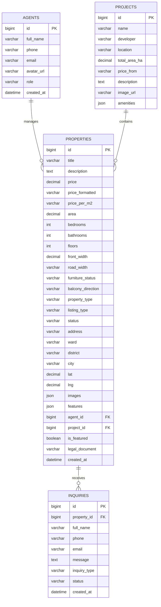

# BATDONGSAN.VN — NỀN TẢNG GIAO DỊCH BẤT ĐỘNG SẢN & PROPTECH CAO CẤP

> **Hệ sinh thái giao dịch nhà đất minh bạch, thẩm định quy hoạch và kết nối đầu tư bất động sản chuẩn xác.**  
> Xây dựng theo ngôn ngữ thiết kế **Modern Editorial PropTech** (Clean Light Mode, Anti-AI Slop, chuẩn kiến trúc).

---

## 1. GIỚI THIỆU TỔNG QUAN (PROJECT OVERVIEW)

**Batdongsan.vn** là nền tảng công nghệ bất động sản (PropTech) toàn diện, giải quyết bài toán giao dịch nhà đất an toàn, minh bạch pháp lý và hỗ trợ người mua, nhà đầu tư đưa ra quyết định dựa trên dữ liệu chuẩn xác.

### Các phân hệ chính:
1. **Cổng Thông Tin Dịch Vụ Toàn Diện (Service Ecosystem):**
   - Thẩm định giá thị trường độc lập qua dữ liệu giao dịch thực tế.
   - Tra cứu bản đồ quy hoạch sử dụng đất 2026 đối chiếu trực tiếp Sở TN&MT.
   - Tư vấn gói vay mua nhà với các đối tác ngân hàng hàng đầu (lãi suất ưu đãi từ 6.5%/năm).
   - Mạng lưới ký gửi & phân phối độc quyền với hơn 250,000+ nhà đầu tư sẵn có.
2. **Bản Đồ Quy Hoạch & Đại Đô Thị Trọng Điểm:**
   - Cập nhật 4 khu đất quy hoạch tiềm năng (Bình Chánh, Cần Giờ, Hòa Lạc, Long Biên).
   - Khám phá các đại đô thị tiêu biểu kèm bảng giá, quy mô và chủ đầu tư uy tín.
3. **Danh Mục Bất Động Sản Bán & Cho Thuê:**
   - Phân loại rõ ràng: Căn hộ, Nhà phố, Biệt thự, Đất nền, Bất động sản thương mại.
   - Bộ lọc đa chiều: Khu vực, khoảng giá, số phòng ngủ, diện tích và tình trạng pháp lý.
4. **Trang Chi Tiết BĐS Chuyên Sâu:**
   - Thư viện ảnh **Luxury Bento Gallery 5 khung** (ngoại cảnh, phòng khách, bếp, phòng ngủ, tiện ích) tích hợp Lightbox toàn màn hình.
   - Bảng tính lãi suất & dự toán dòng tiền vay mua nhà thời gian thực (Interactive Mortgage Calculator).
   - Bản đồ tiện ích lân cận bán kính 1km - 3km (trường học, bệnh viện, metro, trung tâm thương mại).
   - Form đặt lịch xem nhà trực tiếp và liên hệ chuyên viên phụ trách.
5. **Phân Hệ Quản Trị (Admin Dashboard):**
   - Đo lường số lượng tài sản niêm yết, tổng giá trị quỹ đất và số khách hàng tiềm năng.
   - Quản lý danh sách khách hẹn tư vấn (Leads Tracker) với nút liên hệ nhanh.
   - Quản lý và duyệt tin đăng bất động sản.

---

## 2. CÔNG NGHỆ & NGÔN NGỮ SỬ DỤNG (TECH STACK)

### 2.1. Frontend
- **Ngôn ngữ & Framework:** [TypeScript](https://www.typescriptlang.org/) + [React 19](https://react.dev/) + [Vite](https://vitejs.dev/)
- **Icon System:** [Lucide React](https://lucide.dev/) (Bộ icon đường nét mảnh, chuẩn kiến trúc)
- **Styling Architecture:** Pure Vanilla CSS Tokens (Không dùng CSS framework cồng kềnh, tối ưu hiệu năng render tuyệt đối)
- **Design System:** Quy chuẩn thiết kế riêng tại [DESIGN_SYSTEM.md](file:///c:/Users/Tam/Desktop/batdongsan/DESIGN_SYSTEM.md)
  - Tone màu: Trắng tinh khiết (`#ffffff`), Xám phụ trợ (`#f8fafc`), Xanh ngọc bảo chủ đạo (`#059669`)
  - Typography: `Plus Jakarta Sans` (chữ) & `Space Grotesk` (số liệu, đơn giá)
  - Bo góc: 6px – 8px – 12px (kỷ luật, không bo tròn dạng viên thuốc trẻ con)

### 2.2. Backend
- **Ngôn ngữ & Runtime:** [TypeScript](https://www.typescriptlang.org/) + [Node.js](https://nodejs.org/) (v18+)
- **Web Framework:** [Express.js](https://expressjs.com/) (RESTful API Architecture)
- **Development Tooling:** `tsx` (TypeScript Execute & Hot-reload)
- **Middleware & Utility:** `cors`, `dotenv`, `zod` (Data validation)

### 2.3. Cơ sở dữ liệu (Database)
- **Hệ quản trị CSDL:** **MySQL 8.0+**
- **Đặc tả quan hệ (Relational DB):** Chuẩn hóa liên kết bảng dữ liệu 1-N giữa Bất động sản (`properties`), Chuyên viên (`agents`), Khách hẹn (`inquiries`), Quy hoạch (`planning_areas`), và Dự án (`projects`).

---

## 3. THIẾT KẾ CƠ SỞ DỮ LIỆU MYSQL (DATABASE SCHEMA)

Hệ thống được thiết kế lưu trữ tối ưu trên MySQL với các bảng chuẩn hóa sau:



### Script Khởi tạo CSDL MySQL (SQL DDL):

```sql
-- Tạo Database
CREATE DATABASE IF NOT EXISTS batdongsan_db 
CHARACTER SET utf8mb4 
COLLATE utf8mb4_unicode_ci;

USE batdongsan_db;

-- 1. Bảng Chuyên viên tư vấn / Môi giới
CREATE TABLE IF NOT EXISTS agents (
    id BIGINT AUTO_INCREMENT PRIMARY KEY,
    full_name VARCHAR(150) NOT NULL,
    phone VARCHAR(20) NOT NULL,
    email VARCHAR(100) NOT NULL,
    avatar_url VARCHAR(500),
    role VARCHAR(100) DEFAULT 'Chuyên viên tư vấn cấp cao',
    created_at TIMESTAMP DEFAULT CURRENT_TIMESTAMP
);

-- 2. Bảng Đại đô thị & Dự án tiêu biểu
CREATE TABLE IF NOT EXISTS projects (
    id BIGINT AUTO_INCREMENT PRIMARY KEY,
    name VARCHAR(255) NOT NULL,
    developer VARCHAR(150) NOT NULL,
    location VARCHAR(255) NOT NULL,
    total_area_ha DECIMAL(10,2),
    price_from VARCHAR(100),
    description TEXT,
    image_url VARCHAR(500),
    amenities JSON,
    created_at TIMESTAMP DEFAULT CURRENT_TIMESTAMP
);

-- 3. Bảng Tin đăng Bất động sản
CREATE TABLE IF NOT EXISTS properties (
    id BIGINT AUTO_INCREMENT PRIMARY KEY,
    title VARCHAR(255) NOT NULL,
    description TEXT NOT NULL,
    price DECIMAL(15,2) NOT NULL,
    price_formatted VARCHAR(100) NOT NULL,
    price_per_m2 VARCHAR(100),
    area DECIMAL(10,2) NOT NULL,
    bedrooms INT DEFAULT 0,
    bathrooms INT DEFAULT 0,
    floors INT DEFAULT 1,
    front_width DECIMAL(8,2),
    road_width VARCHAR(100),
    furniture_status VARCHAR(150),
    balcony_direction VARCHAR(50),
    property_type ENUM('apartment', 'house', 'villa', 'land', 'commercial') NOT NULL,
    listing_type ENUM('sale', 'rent') NOT NULL DEFAULT 'sale',
    status ENUM('available', 'sold', 'pending') NOT NULL DEFAULT 'available',
    address VARCHAR(255) NOT NULL,
    ward VARCHAR(100) NOT NULL,
    district VARCHAR(100) NOT NULL,
    city VARCHAR(100) NOT NULL,
    lat DECIMAL(10,8),
    lng DECIMAL(11,8),
    images JSON NOT NULL,
    features JSON,
    agent_id BIGINT,
    project_id BIGINT NULL,
    is_featured BOOLEAN DEFAULT FALSE,
    year_built INT,
    direction VARCHAR(50),
    legal_document VARCHAR(150) DEFAULT 'Sổ hồng lâu dài',
    created_at TIMESTAMP DEFAULT CURRENT_TIMESTAMP,
    FOREIGN KEY (agent_id) REFERENCES agents(id) ON DELETE SET NULL,
    FOREIGN KEY (project_id) REFERENCES projects(id) ON DELETE SET NULL,
    INDEX idx_city_district (city, district),
    INDEX idx_price (price),
    INDEX idx_type (property_type, listing_type)
);

-- 4. Bảng Tiện ích xung quanh BĐS (Bán kính 1-3km)
CREATE TABLE IF NOT EXISTS nearby_amenities (
    id BIGINT AUTO_INCREMENT PRIMARY KEY,
    property_id BIGINT NOT NULL,
    name VARCHAR(150) NOT NULL,
    distance VARCHAR(50) NOT NULL,
    amenity_type ENUM('transport', 'education', 'shopping', 'hospital', 'park') NOT NULL,
    FOREIGN KEY (property_id) REFERENCES properties(id) ON DELETE CASCADE
);

-- 5. Bảng Khách hẹn xem nhà & Yêu cầu tư vấn (Leads)
CREATE TABLE IF NOT EXISTS inquiries (
    id BIGINT AUTO_INCREMENT PRIMARY KEY,
    property_id BIGINT NULL,
    property_title VARCHAR(255),
    full_name VARCHAR(150) NOT NULL,
    phone VARCHAR(20) NOT NULL,
    email VARCHAR(100),
    message TEXT,
    inquiry_type ENUM('viewing', 'consultation', 'price_offer') DEFAULT 'viewing',
    status ENUM('new', 'contacted', 'scheduled', 'completed', 'cancelled') DEFAULT 'new',
    created_at TIMESTAMP DEFAULT CURRENT_TIMESTAMP,
    FOREIGN KEY (property_id) REFERENCES properties(id) ON DELETE SET NULL,
    INDEX idx_inquiry_status (status)
);
```

---

## 4. CẤU TRÚC THƯ MỤC DỰ ÁN (PROJECT STRUCTURE)

```
batdongsan/
├── README.md                            # Tài liệu tổng quan & hướng dẫn cài đặt dự án
├── DESIGN_SYSTEM.md                     # Tài liệu đặc tả hệ thống thiết kế & UI Tokens chuẩn
│
├── frontend/                            # Giao diện người dùng & quản trị (React 19 + TypeScript + Vite)
│   ├── public/                          # Tài nguyên tĩnh
│   ├── src/
│   │   ├── views/                       # Các màn hình chính phân theo vai trò
│   │   │   ├── user/                    # Giao diện Khách hàng (Client-Facing)
│   │   │   │   ├── HomeView.tsx         # Trang chủ: Dịch vụ, quy hoạch, dự án, giới thiệu
│   │   │   │   ├── ListingView.tsx      # Danh mục: Nhà đất bán & cho thuê + bộ lọc
│   │   │   │   ├── PropertyDetailView.tsx # Chi tiết BĐS: Bento gallery, tính lãi vay, tiện ích
│   │   │   │   └── FavoritesView.tsx    # Danh sách tài sản đã lưu yêu thích
│   │   │   └── admin/                   # Phân hệ Quản trị viên (Admin Portal)
│   │   │       └── AdminDashboardView.tsx # Bảng số liệu, quản lý Leads & danh sách BĐS
│   │   │
│   │   ├── components/                  # Thành phần giao diện dùng chung
│   │   │   ├── common/                  # Navbar, Footer
│   │   │   ├── property/                # PropertyCard, FilterBar, Hero
│   │   │   └── modals/                  # ProjectDetailModal, ServiceConsultModal
│   │   │
│   │   ├── services/
│   │   │   └── api.ts                   # Client kết nối RESTful API backend
│   │   ├── types/
│   │   │   ├── property.ts              # Kiểu dữ liệu BĐS & Bộ lọc
│   │   │   └── inquiry.ts               # Kiểu dữ liệu Khách hẹn & Yêu cầu tư vấn
│   │   ├── App.tsx                      # Root View Router & State Controller
│   │   ├── index.css                    # Design Tokens, Biến CSS & Reset chuẩn
│   │   └── main.tsx                     # Entry point React
│   └── package.json
│
└── backend/                             # Dịch vụ API máy chủ (Node.js + Express + TypeScript)
    ├── src/
    │   ├── controllers/                 # Bộ điều phối xử lý Request & Response
    │   │   ├── property.controller.ts   # Xử lý danh mục & chi tiết BĐS
    │   │   └── inquiry.controller.ts    # Xử lý tiếp nhận đơn đặt hẹn / tư vấn
    │   ├── services/                    # Tầng nghiệp vụ dữ liệu (Business Logic)
    │   │   ├── property.service.ts      # Truy vấn, tìm kiếm & lọc BĐS
    │   │   └── inquiry.service.ts       # Lưu trữ & quản lý khách hẹn
    │   ├── routes/                      # Định tuyến API Endpoints
    │   │   ├── property.routes.ts       # Router /api/properties
    │   │   ├── inquiry.routes.ts        # Router /api/inquiries
    │   │   └── index.ts                 # Tổng hợp API Router
    │   ├── types/                       # Khai báo kiểu TypeScript của Backend
    │   ├── app.ts                       # Khởi tạo Express, Middleware, CORS
    │   └── server.ts                    # Server Listener
    ├── tsconfig.json
    └── package.json
```

---

## 5. HƯỚNG DẪN CÀI ĐẶT & KHỞI CHẠY (GETTING STARTED)

### 5.1. Yêu cầu môi trường
- [Node.js](https://nodejs.org/) phiên bản `18.0` trở lên
- [MySQL Server](https://dev.mysql.com/downloads/mysql/) phiên bản `8.0` trở lên (hoặc MySQL trên XAMPP / Docker)
- Trình quản lý gói `npm` (đi kèm Node.js)

### 5.2. Cấu hình Cơ sở dữ liệu MySQL
1. Khởi động dịch vụ MySQL.
2. Mở MySQL Workbench hoặc chạy lệnh terminal để nhập đoạn script DDL tại **Mục 3**:
   ```bash
   mysql -u root -p < schema.sql
   ```
3. Tạo file cấu hình biến môi trường `backend/.env`:
   ```env
   PORT=5001
   NODE_ENV=development
   
   # MySQL Connection Config
   DB_HOST=localhost
   DB_PORT=3306
   DB_USER=root
   DB_PASSWORD=your_mysql_password
   DB_NAME=batdongsan_db
   ```

### 5.3. Khởi chạy Backend API
Mở terminal tại thư mục `backend`:
```bash
cd backend

# Cài đặt các thư viện phụ thuộc
npm install

# Khởi chạy máy chủ ở chế độ phát triển (Hot-reload)
npm run dev
```
> Backend API sẽ lắng nghe tại: `http://localhost:5001`

### 5.4. Khởi chạy Frontend Web App
Mở một cửa sổ terminal mới tại thư mục `frontend`:
```bash
cd frontend

# Cài đặt các thư viện phụ thuộc
npm install

# Khởi chạy Vite dev server
npm run dev
```
> Ứng dụng web sẽ khả dụng tại: `http://localhost:5173`

---

## 6. DANH SÁCH API ENDPOINTS (API SPECIFICATION)

| Phương thức | Đường dẫn API | Mô tả | Tham số truy vấn (Query Params) |
| :--- | :--- | :--- | :--- |
| `GET` | `/api/properties` | Lấy danh sách BĐS kèm bộ lọc | `search`, `city`, `propertyType`, `listingType`, `minPrice`, `maxPrice`, `bedrooms`, `sortBy` |
| `GET` | `/api/properties/featured` | Lấy danh sách BĐS nổi bật trang chủ | Không |
| `GET` | `/api/properties/locations` | Lấy danh sách các tỉnh/thành phố có tin đăng | Không |
| `GET` | `/api/properties/:id` | Lấy chi tiết thông tin của một BĐS | `id` (Param) |
| `POST` | `/api/properties` | Tạo tin đăng BĐS mới (Dành cho Quản trị) | Request Body (JSON) |
| `POST` | `/api/inquiries` | Gửi yêu cầu đặt lịch xem nhà / đăng ký dịch vụ | `propertyId`, `fullName`, `phone`, `email`, `message`, `inquiryType` |
| `GET` | `/api/inquiries` | Lấy danh sách tất cả khách hẹn tư vấn (Admin) | Không |

---

## 7. QUY CHUẨN THIẾT KẾ & THAM CHIẾU (DESIGN REFERENCE)

Toàn bộ quy chuẩn về bảng màu Hex, tỷ lệ phông chữ, khoảng cách khung lưới, bo góc, bóng đổ và mẫu mã các thành phần giao diện (Cards, Bento Gallery, Calculator, Buttons, Modals) được ghi chép đầy đủ tại:
👉 **[DESIGN_SYSTEM.md](file:///c:/Users/Tam/Desktop/batdongsan/DESIGN_SYSTEM.md)**

---

## 8. GIẤY PHÉP & BẢN QUYỀN (LICENSE)

Dự án được xây dựng và phát hành theo giấy phép **MIT License**. Mọi quyền được bảo lưu bởi đội ngũ phát triển Batdongsan.vn.
